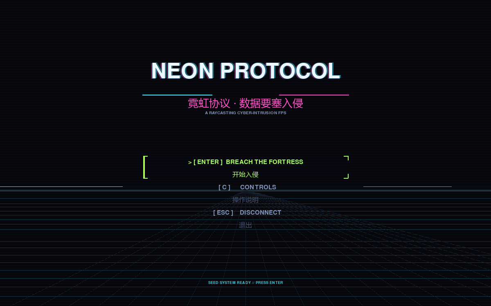
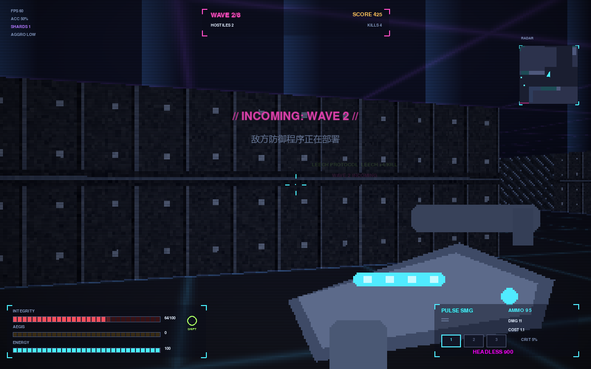
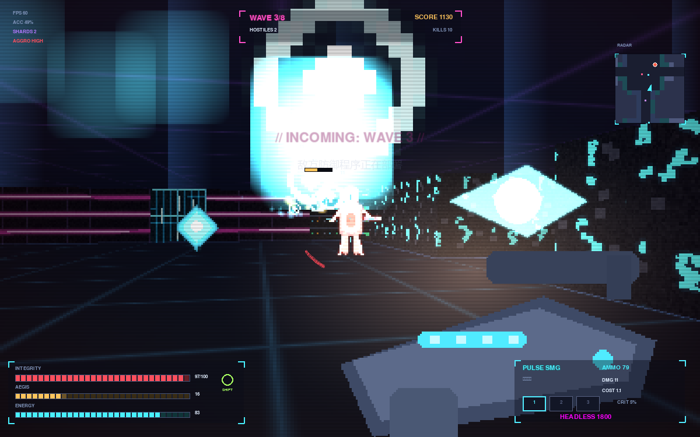
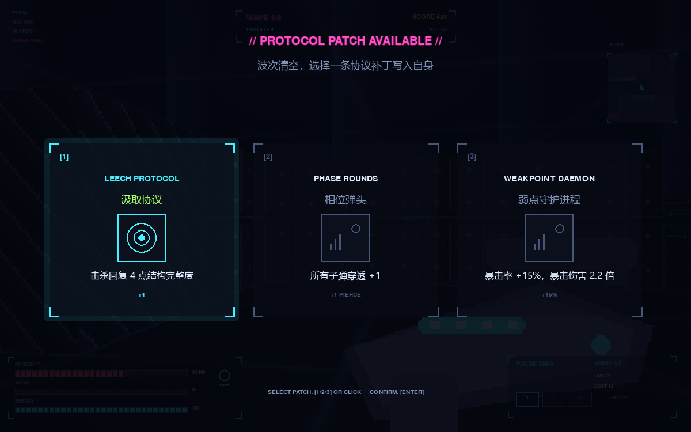
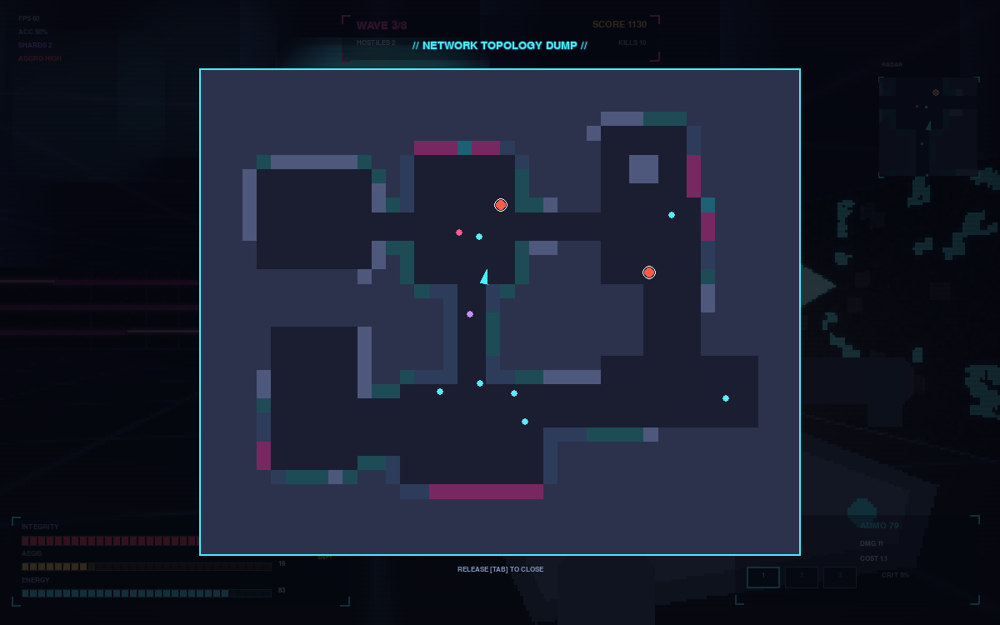

<div align="center">



[](https://www.python.org)
[](https://www.pygame.org)
[](#特性)
[](#特性)
[](LICENSE)

**霓虹协议 · 数据要塞入侵**

*纯 Python + NumPy 手写的赛博朋克光线投射 FPS —— 无游戏引擎、无贴图文件、无音频文件，所有画面与声音运行时程序化生成。*

[特性](#特性) · [截图](#截图预览) · [快速开始](#快速开始) · [无头模式](#无头--调试) · [架构](#项目结构) · [许可](#许可)

</div>

---

## 截图预览

| 战斗 | 敌潮 |
|:---:|:---:|
|  |  |
| **协议补丁（局内成长）** | **全网拓扑（Tab 全屏地图）** |
|  |  |

## 玩法

你是一个被上传进敌方内网的黑客进程（代号 **GHOST**）。要塞里部署了四类 ICE 防御程序，
它们会沿掩体追猎你。在 8 波不断增强的攻势中存活下来，并用途中拾取的「协议补丁」强化自己。

## 操作

| 按键 | 动作 |
|:---:|:---|
| **W A S D** | 移动（相对视角方向，带惯性） |
| **鼠标** | 转向瞄准 |
| **左键** | 开火 |
| **Shift** | 冲刺（短暂无敌帧，唯一的主动防御手段） |
| **1 / 2 / 3** | 切换武器 |
| **Tab** | 全屏网络拓扑图 |
| **ESC** | 暂停 |

## 特性

- **自研光线投射引擎** —— 墙体 / 地板 / 精灵 / 粒子全部用 NumPy 向量化计算，60 FPS，零贴图依赖；霓虹纹理程序化生成。
- **流场寻路（Flow Field）** —— 敌人沿 BFS 距离场绕墙推进，不顶墙、不抖动；失去视线自动绕路。
- **有限状态机 AI** —— `idle → alert → chase → attack → dead`，感知系统含视线 + 距离 + 视野锥 + 听觉。
- **实时合成音频** —— 音效全部由 NumPy 波形合成运行时生成，仓库里一个 `.wav` 都没有。
- **固定步长物理（1/120s）** —— 低帧率机器上移动手感与 AI 反应完全一致。
- **波次 + 局内 build** —— 每波清空抽 3 张协议补丁（穿透、暴击、汲取…），组合出你的流派。
- **CRT 后处理** —— 扫描线、暗角、画面撕裂，阴极射线管质感一步到位。

## 快速开始

```bash
# 要求：Python 3.8+
git clone https://github.com/WsNodeX/neon-protocol.git
cd neon_protocol

# 创建虚拟环境并安装依赖
python -m venv venv
venv\Scripts\activate        # Windows
pip install pygame numpy

# 启动
python -m neon_protocol.main
```

## 无头 / 调试

```bash
python -m neon_protocol.main --headless --frames 3000   # 机器人自动跑图，输出性能报告
python -m neon_protocol.main --bench                    # 渲染分层基准测试
python -m neon_protocol.main --res 640x400 --scale 2    # 调分辨率 / 整数放大
```

## 项目结构

```
neon_protocol/
  main.py       启动入口、参数解析、无头压测 / 截图 / 基准
  game.py       主循环、状态机、输入、固定步长物理、渲染编排、世界状态
  entities.py   玩家 / 敌人 / 子弹 / 掉落物 / 粒子
  level.py      随机要塞生成（房间 + 走廊）
  renderer.py   光线投射渲染与 CRT 后处理（扫描线 / 暗角 / 撕裂）
  hud.py        界面叠层（武器 / 血量 / 小地图 / 升级卡）
  textures.py   程序化纹理与武器精灵
  audio.py      实时波形合成音效
  config.py     全局数值（所有「魔法数字」集中管理）
  utils.py      数学 / 几何工具
```

## 技术要点

| 模块 | 实现 |
|:---|:---|
| 渲染 | 逐列 DDA 光线投射，墙体 / 地板 / 天空 NumPy 向量化，精灵深度排序 + 遮挡裁剪 |
| 寻路 | BFS 距离场 → 流场方向图，全图敌人共享一张场，O(1) 查询移动方向 |
| AI | 有限状态机 + 感知（视线射线 / 视野锥 / 听觉半径），冲突避免分离力 |
| 物理 | 固定 1/120s 步长 + 渲染插值，贴墙滑动（轴分离碰撞） |
| 音频 | NumPy 合成（方波 / 噪声 / 包络），`mixer.Sound(array)` 直接播放 |

## 许可

[MIT](LICENSE) —— 自由使用、修改、再分发。
